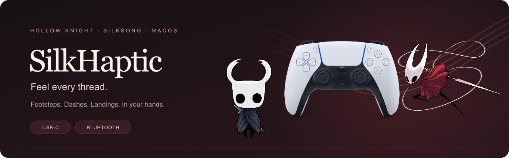

  

SilkHaptic uses the haptic effects already included in your copy of **Hollow Knight** and **Hollow Knight: Silksong**. Instead of feeling the same basic buzz for everything, you can feel the different textures of movement and action through a DualSense controller.

| Plug in | Go wireless | Launch and play |
| :--- | :--- | :--- |
| Connect your controller with a USB-C data cable. | Pair it with your Mac over Bluetooth. | The haptic companion starts and closes with the game. |

## What you need

- **Hollow Knight or Hollow Knight: Silksong for macOS.** Original Hollow Knight needs the updated Unity 6 build; older builds such as 1.5.78 aren’t supported.
- **BepInEx 5, already installed and working.** This is the mod loader that lets the game run SilkHaptic.
- **A DualSense controller**, connected by USB or Bluetooth.
- **macOS 12 or newer.**

Tested in gameplay on an Apple Silicon Mac with a standard DualSense, using both connections. Intel builds and DualSense Edge support are included, but haven’t been tested on those devices.

## Get started

### 1. Download and install

Download **[SilkHaptic-macOS-v1.2.0.zip](https://github.com/faridbtw/SilkHaptic/releases/download/v1.2.0/SilkHaptic-macOS-v1.2.0.zip)** from the release page and unzip it.

Quit the game, then choose its installer inside the extracted folder:

| Game | Install | Launch |
| :--- | :--- | :--- |
| Hollow Knight | `Install Hollow Knight.command` | `Launch Modded Hollow Knight.command` |
| Hollow Knight: Silksong | `Install.command` | `Launch Modded Silksong.command` |

The installer finds the usual Steam installation and prepares that game’s haptic effects from your own game files. Both games use the same download.

> Choose the **SilkHaptic macOS ZIP** under the release’s Assets section. GitHub’s “Source code” downloads are for building the project yourself.

### 2. Connect your controller

| USB-C | Bluetooth |
| :--- | :--- |
| Plug the controller into your Mac using a **data cable**. | Hold **Create + PS** until the light flashes. Open **System Settings → Bluetooth** and connect **DualSense Wireless Controller**. |
| Gives you the most consistent timing and full waveform detail. | Lets you play without a cable. Timing and detail can differ from USB. |

**Switch whenever you like.** USB takes priority when plugged in. Unplug it, and SilkHaptic uses Bluetooth if the controller is connected wirelessly.

### 3. Play

Open the launch command for your game from the table above, or launch through Steam **if you’ve already configured Steam to load BepInEx**. The Hollow Knight launcher uses Rosetta on Apple Silicon for BepInEx 5 compatibility; keep Steam running.

The haptic companion opens automatically. Keep your usual speakers or headphones selected for game audio.

In both games, the DualSense light bar glows purple in menus, warm white at full health, amber as health drops, and red at one mask. It flashes red when you take damage. Hollow Knight also counts Lifeblood masks. Set `AdaptiveLightbar` to `false` in the [SilkHaptic settings](docs/ADVANCED.md#settings) if you prefer to turn this off.

## Update or remove

**Update:** quit the game, extract the new release, and run its installer again. Your previous SilkHaptic installation is backed up automatically.

**Remove:** quit the game and run `Uninstall Hollow Knight.command` for Hollow Knight, or `Uninstall.command` for Silksong. Your saves and other mods are left in place.
