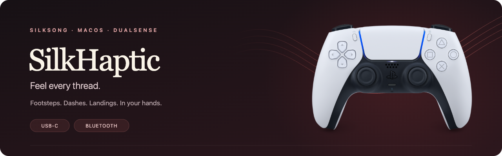

  

SilkHaptic uses the haptic effects already included in your copy of **Hollow Knight: Silksong**. Instead of feeling the same basic buzz for everything, you can feel the different textures of movement and action through a DualSense controller.

| Plug in | Go wireless | Launch and play |
| :--- | :--- | :--- |
| Connect your controller with a USB-C data cable. | Pair it with your Mac over Bluetooth. | The haptic companion starts and closes with the game. |

## What you need

- **Hollow Knight: Silksong for macOS.**
- **BepInEx 5, already installed and working.** This is the mod loader that lets the game run SilkHaptic.
- **A DualSense controller**, connected by USB or Bluetooth.
- **macOS 12 or newer.**

Tested in gameplay on an Apple Silicon Mac with a standard DualSense, using both connections. Intel builds and DualSense Edge support are included, but haven’t been tested on those devices.

## Get started

### 1. Download and install

Download **[SilkHaptic-macOS-v1.0.zip](https://github.com/faridbtw/SilkHaptic/releases/download/v1.0/SilkHaptic-macOS-v1.0.zip)** from the release page and unzip it.

Quit Silksong, then double-click **`Install.command`** inside the extracted folder. The installer finds the usual Steam installation and prepares the haptic effects from your own game files.

> Choose the **SilkHaptic macOS ZIP** under the release’s Assets section. GitHub’s “Source code” downloads are for building the project yourself.

### 2. Connect your controller

| USB-C | Bluetooth |
| :--- | :--- |
| Plug the controller into your Mac using a **data cable**. | Hold **Create + PS** until the light flashes. Open **System Settings → Bluetooth** and connect **DualSense Wireless Controller**. |
| Gives you the most consistent timing and full waveform detail. | Lets you play without a cable. Timing and detail can differ from USB. |

**Switch whenever you like.** USB takes priority when plugged in. Unplug it, and SilkHaptic uses Bluetooth if the controller is connected wirelessly.

### 3. Play

Open **`Launch Modded Silksong.command`** from the extracted folder, or launch through Steam **if you’ve already configured Steam to load BepInEx**.

That’s it. The haptic companion opens automatically. Keep your usual speakers or headphones selected for game audio.

## Update or remove

**Update:** quit the game, extract the new release, and run `Install.command` again. Your previous SilkHaptic installation is backed up automatically.

**Remove:** quit the game and run `Uninstall.command`. It moves SilkHaptic out of the active mods folder. Your saves and other mods are left in place.
